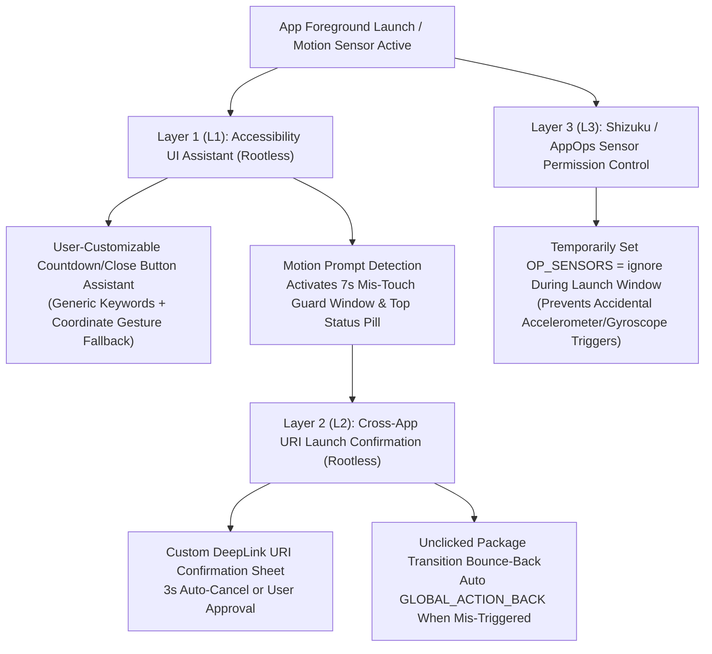

# 🛡️ ShakeGuard (摇一摇守卫)

**[🇺🇸 English](README.md) | [🇨🇳 简体中文](README_ZH.md) | [⚖️ Legal Disclaimer / 免责声明](DISCLAIMER.md)**

> **Open-Source Android Motion-Sensor Mis-Touch Guard & Cross-App URI Launch Confirmation Utility**  
> An educational & accessibility assistance project built with pure Android SDK + Kotlin. Zero internet permissions, 100% offline, vendor-neutral (zero hardcoded third-party app/SDK rules), with instant in-app **English / 简体中文** language switching.

---

## ⚖️ Compliance & Fair Use Notice (Important)

- **Educational & Accessibility Purpose**: Designed to study Android `AccessibilityService`, implicit `Intent` confirmation dialogs, and `AppOps` sensor permission management, helping users prevent accidental accelerometer/gyroscope triggers during bumpy rides or hand tremors.
- **100% Vendor-Neutral**: This repository and its APKs contain **NO hardcoded rules, package names, URI schemes, or view IDs targeting any specific third-party company or commercial SDK**. Built-in rules use generic placeholders (`com.example.*`, `shakeguarddemo://`) only. All custom rules are configured locally by the end user on their own device. See [DISCLAIMER.md](DISCLAIMER.md) for full details.

---

## 📦 Direct APK Downloads (v1.3.0)

| Edition | Default UI Language | In-App Language Switch | Download Link |
|---|---|---|---|
| 🇺🇸 **English Edition** | **English (`en-US`)** | Tap `🌐 中文` in top bar | [**Download `ShakeGuard-v1.3.0-en-US.apk`**](https://github.com/xuanbin159/shake-guard/releases/download/v1.3.0/ShakeGuard-v1.3.0-en-US.apk) |
| 🇨🇳 **Chinese Edition (中文版)** | **简体中文 (`zh-CN`)** | Tap `🌐 EN` in top bar | [**下载 `ShakeGuard-v1.3.0-zh-CN.apk`**](https://github.com/xuanbin159/shake-guard/releases/download/v1.3.0/ShakeGuard-v1.3.0-zh-CN.apk) |

---

## 🚀 Technical Architecture (3-Layer Defense-in-Depth)



---

## ✨ Core Modules

1. **Layer 1 (L1): Accessibility Interaction & Mis-Touch Assistant (`ShakeGuardAccessibilityService`)**
   - Assists with clicking user-defined countdown/close buttons and activates a temporary 7-second mis-touch protection lock when motion/shake prompts appear on screen.
   - Displays a non-intrusive status banner via `TYPE_ACCESSIBILITY_OVERLAY` (requires no extra floating-window permissions).
2. **Layer 2 (L2): Cross-App URI Launch Confirmation (`DeepLinkInterceptorActivity`)**
   - Provides a translucent bottom-sheet confirmation dialog before launching external URI schemes, preventing accidental cross-app jumps caused by unintentional device movement.
3. **Layer 3 (L3): Shizuku / AppOps Sensor Permission Manager (`ShizukuSensorController`)**
   - Uses Android's native `AppOpsManager` (`cmd appops set <pkg> SENSORS ignore`) via Shizuku or ADB to temporarily pause accelerometer/gyroscope access during the first $N$ seconds of app startup (or permanently for user-selected apps).
4. **🧪 Built-in Motion Sensor Hardware Sandbox Lab (`ShakeAdLabActivity`)**
   - Visualizes real-time hardware accelerometer and gyroscope waveforms ($\Delta a$) and lets users test L1/L2/L3 behaviors against generic sandbox URI schemes (`shakeguarddemo://`).

---

## 🔓 Android 13 / 14 / 15 "Restricted Settings" & OEM Battery Whitelist Guide

### 1. Unlocking "Restricted Settings" on Android 13+ (No PC Needed)
1. Open **ShakeGuard** and tap **"Step 2: Open Accessibility Settings"** -> tap **ShakeGuard** once to trigger the system prompt.
2. Return to **ShakeGuard** and tap **"🔓 Step 1: Open App Info"** (`Settings -> Apps -> ShakeGuard`).
3. Tap **`⋮` (three dots)** in the top-right corner (or bottom on Xiaomi HyperOS) and select **"Allow restricted settings"**.
4. Return to **Accessibility Settings** and toggle **ShakeGuard** ON.

### 2. One-Line ADB Command (Optional)
```bash
adb install -r -g dist/ShakeGuard-v1.3.0-en-US.apk && \
adb shell appops set cn.shakeguard.app ACCESS_RESTRICTED_SETTINGS allow && \
adb shell settings put secure enabled_accessibility_services cn.shakeguard.app/cn.shakeguard.app.service.ShakeGuardAccessibilityService && \
adb shell settings put secure accessibility_enabled 1
```

---

## 🛠️ Building from Source

```bash
# Build both English (en-US) and Chinese (zh-CN) signed APKs:
PYTHONPATH=src python3 -m shake_guard build

# Run automated verification tests:
PYTHONPATH=src python3 tests/test_shake_guard.py
```

---

## 📄 License

MIT License — See [DISCLAIMER.md](DISCLAIMER.md) for legal and compliance terms.
